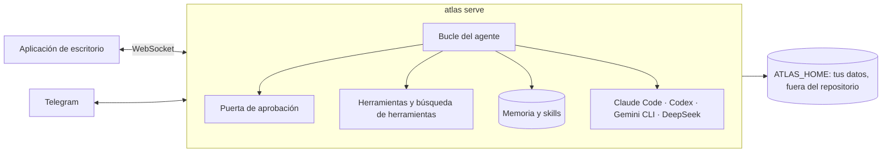

<p align="center">
  <picture>
    <source media="(prefers-color-scheme: dark)" srcset="docs/assets/logo-dark.png">
    
  </picture>
</p>

<h1 align="center">Atlas</h1>

<p align="center">
  <strong>Un agente personal que vive en tu máquina, recuerda lo que importa y le pasa el trabajo pesado al agente adecuado.</strong>
</p>

<p align="center">
  <a href="https://github.com/marqueskaio/atlas/actions/workflows/ci.yml"></a>
  <a href="LICENSE"></a>
  
  
</p>

<p align="center">
  <a href="README.md">English</a> · <a href="README.pt-BR.md">Português</a> · <b>Español</b> · <a href="README.zh-CN.md">中文</a>
</p>

---

Atlas es un agente personal de código abierto, con una aplicación de escritorio. Pon una clave de
API y tienes un asistente que guarda una memoria que puedes leer, escribe sus propias skills a
medida que aprende cómo trabajas, ejecuta rutinas programadas y dirige Claude Code, Codex, Gemini
CLI o el harness de DeepSeek cuando uno de ellos es la herramienta adecuada. Funciona en tu
portátil, en un servidor o en un contenedor, y todo lo que sabe de ti queda en una carpeta tuya.

## Por qué Atlas

- **El harness es ligero; el que trabaja es el modelo.** Atlas mejora cada vez que mejoran los
  modelos. Mantiene pocas herramientas siempre activas y encuentra el resto por búsqueda, así que
  cada llamada al modelo es pequeña y enfocada.
- **La memoria es texto plano.** Tu perfil y las notas del agente son archivos que puedes abrir,
  editar y versionar. Ninguna base vectorial oculta decidiendo lo que dijiste.
- **Seguro por diseño.** Cada comando pasa por una puerta de aprobación. Algunas cosas nunca se
  ejecutan, en ningún modo. Todo lo que sale de tu máquina en tu nombre, como fusionar un pull
  request o enviar un correo, siempre pregunta antes.
- **Tuyo.** Sin cuenta, sin telemetría, sin nube nuestra. Usa el proveedor de modelos que prefieras.

## Mejora mientras trabajas

Cada pocos mensajes, una copia del agente relee la conversación en segundo plano y guarda lo que
enseñó, para que nunca tengas que corregir lo mismo dos veces:

- **Quién eres** va a tu perfil, y **los datos de tu entorno** (manías de herramientas, rutas,
  convenciones) a las notas del agente.
- **Cómo se hace un tipo de tarea** se convierte en una skill. Cuando corriges su estilo o su
  forma de trabajar, cuando aparece un arreglo o un atajo, o cuando una skill resulta equivocada,
  ajusta la skill que lo cubre, y solo crea una nueva cuando ninguna lo hace.
- **Ignora el ruido:** un programa que faltaba, una tarea puntual, un error que desapareció solo.

No puede romper nada a escondidas. Los datos nuevos se aplican al momento, pero todo lo que
reemplazaría o borraría un recuerdo espera como propuesta hasta que lo apruebes. Nunca borra una
skill, cada cambio guarda la versión anterior (`atlas skills revert` la recupera), y las skills que
creó y llevan 30 días sin usarse se archivan, nunca las tuyas.

## Qué hace

| | |
|---|---|
| 🧠 **Memoria que puedes leer** | Un perfil tuyo y las notas del propio agente, guardados como texto dentro de un límite fijo. Ábrelos, edítalos o pregúntale a Atlas qué sabe. |
| 🛠️ **Skills que escribe él mismo** | Cuando Atlas aprende cómo se hace algo, guarda una skill, con versiones y deshacer. Incluye skills para GitHub, Gmail y Google Calendar. |
| 🤝 **Delega en otros agentes** | Claude Code, Codex, Gemini CLI y el harness de DeepSeek son ejecutores: Atlas abre sesiones en ellos, las sigue y cambia de cuenta. Los subagentes reparten trabajos grandes en paralelo. |
| ⏰ **Rutinas** | Prompts y comandos programados, escritos en palabras ("every weekday at 9") o en cron. |
| 🤖 **Bots** | Agentes con nombre, cada uno con su misión, memoria, skills y rutinas, junto al principal. Se escriben entre ellos. |
| 📱 **Telegram** | Habla con Atlas desde el móvil. Solo entran las personas que emparejes. |
| 🌐 **Un navegador propio** | Atlas maneja su propio Chrome, y puedes tomar el control en cualquier momento. |
| 🔐 **Puerta de aprobación y bóveda** | Los comandos peligrosos preguntan, los peores nunca se ejecutan, un modelo revisor lee los comandos marcados y un modo automático te deja ceder el volante. Las claves de API viven en una bóveda cifrada. |
| 🧩 **Plugins** | Añade skills, comandos, agentes, hooks, monitores, servidores MCP y herramientas. Los hooks usan los eventos y el JSON de Claude Code. |
| 🖥️ **Varias máquinas, varias casas** | Una sola aplicación llega a Atlas en tus otros ordenadores por SSH o Tailscale. Casas separadas mantienen aparte el trabajo y la vida personal. |
| 📦 **Copias de seguridad y gasto** | Un zip con tus datos (nunca la bóveda) y una restauración que lo comprueba antes. Gasto por día, modelo y propósito. |

## Instalación

**Windows**, en PowerShell:

```powershell
irm https://gist.githubusercontent.com/marqueskaio/4e04aef1d784d6d6518f12e466621266/raw/install.ps1 | iex
```

**macOS y Linux**, en una terminal:

```bash
curl -fsSL https://gist.githubusercontent.com/marqueskaio/4e04aef1d784d6d6518f12e466621266/raw/install.sh | bash
```

El instalador trae todo lo que Atlas necesita (su propio Python, Node y herramientas, comprobados
contra hashes fijados), compila la aplicación de escritorio y la abre. La aplicación pide la clave
de API de un proveedor de modelos, y ya estás hablando con Atlas. Para actualizar, ejecuta la misma
línea otra vez; `atlas update` también lo hace, y vuelve a donde estaba si algún paso falla.

**En un contenedor:** el principio de [docker-compose.yml](docker-compose.yml) tiene los tres
comandos: arrancarlo, guardar una clave de API y obtener el token que necesita la aplicación.

### Proveedores de modelos

OpenAI, Anthropic, Google Gemini y OpenRouter con clave de API, y modelos locales con Ollama o
vLLM. Cada conversación puede cambiar de modelo.

## Cómo funciona



Atlas tiene su propio bucle de agente, sin ningún framework de agentes debajo: habla con el SDK
oficial de cada proveedor. El servidor es la única fuente de verdad, y la aplicación de escritorio,
Telegram y las otras máquinas son sus clientes. Todo lo tuyo (perfil, memoria, conversaciones,
ajustes, bóveda) vive en `ATLAS_HOME`, nunca en el código.

## Documentación

Los documentos están en inglés.

- [Memoria](docs/MEMORY.md): qué recuerda Atlas, cómo, y cómo cambiarlo
- [Herramientas](docs/TOOLS.md): cada herramienta del agente, y cómo se encuentra el resto
- [Bots](docs/BOTS.md): crear un bot y hablar con él
- [Revisión en segundo plano](docs/BACKGROUND_REVIEW.md): cómo aprende Atlas de una conversación
- [Plugins](docs/PLUGINS.md): escribir un plugin
- [Arquitectura](docs/ARCHITECTURE.md): las decisiones y las reglas que sigue el código
- [Glosario](docs/GLOSSARY.md): las palabras que usa Atlas

## Estado

Atlas es joven y avanza rápido. Se usa a diario, y una gran batería de pruebas corre en cada cambio:
pruebas unitarias, la aplicación de escritorio real de punta a punta, los instaladores en Windows y
Linux, y la imagen del contenedor. Espera asperezas y cambios entre versiones. El plan está en
[ROADMAP.md](ROADMAP.md) (en portugués).

## Contribuir

Los issues y pull requests son bienvenidos. Lee [AGENTS.md](AGENTS.md) para saber cómo trabajar en
el código, y [docs/ARCHITECTURE.md](docs/ARCHITECTURE.md) antes de escribir nada: el CI hace cumplir
sus reglas.

```bash
uv sync                 # instala (uv gestiona Python 3.13)
uv run pytest           # pruebas
uv run atlas serve      # el servidor, en 127.0.0.1:18790
cd apps/desktop && npm ci && npm run dev   # la aplicación, desde el código
```

## Licencia

[MIT](LICENSE). Algunos archivos contienen reglas y casos de prueba de otros proyectos MIT; cada uno
lo dice en su propia cabecera, y el texto de la licencia está en [LICENSES/](LICENSES/).
