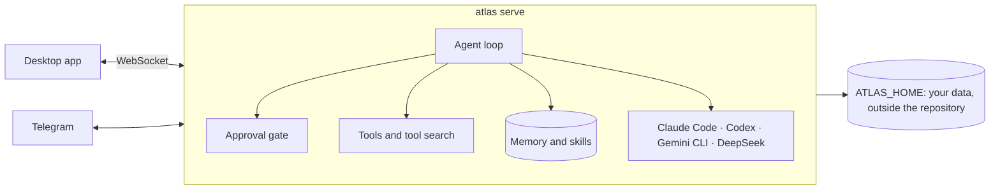

<p align="center">
  <picture>
    <source media="(prefers-color-scheme: dark)" srcset="docs/assets/logo-dark.png">
    
  </picture>
</p>

<h1 align="center">Atlas</h1>

<p align="center">
  <strong>A personal agent that lives on your machine, remembers what matters, and hands the heavy work to the best agent for it.</strong>
</p>

<p align="center">
  <a href="https://github.com/marqueskaio/atlas/actions/workflows/ci.yml"></a>
  <a href="LICENSE"></a>
  
  
</p>

<p align="center">
  <b>English</b> · <a href="README.pt-BR.md">Português</a> · <a href="README.es.md">Español</a> · <a href="README.zh-CN.md">中文</a>
</p>

---

Atlas is an open-source personal agent with a desktop app. Plug in an API key and you have an
assistant that keeps a memory you can read, writes its own skills as it learns how you work, runs
routines on a schedule, and drives Claude Code, Codex, the Gemini CLI or DeepSeek's harness when
one of them is the right tool for the job. It runs on your laptop, on a server or in a container,
and everything it knows about you stays in a folder you own.

## Why Atlas

- **The harness stays thin; the model does the work.** Atlas gets better every time models do. It
  keeps only a few tools always on and finds the rest by search, so every model call stays small
  and focused.
- **Memory is plain text.** Your profile and the agent's notes are files you can open, edit and
  version. No hidden vector store deciding what you said.
- **Safe by construction.** Every command goes through an approval gate. Some things never run, no
  matter the mode. Anything that leaves your machine on your behalf, like merging a pull request or
  sending an email, always asks you first.
- **Yours.** No account, no telemetry, no cloud of ours. Bring the model provider you like.

## It gets better as you work

Every few messages, a copy of the agent rereads the conversation in the background and keeps what
it taught, so you never have to correct the same thing twice:

- **Who you are** goes to your profile, and **facts about your setup** (tool quirks, paths,
  conventions) to the agent's notes.
- **How to do a kind of task** goes to a skill. When you correct its style or way of working, when
  a fix or workaround turns up, or when a skill proves wrong, it patches the skill that covers it,
  and writes a new one only when none does.
- **It skips the noise:** a missing program, a one-off task, an error that went away.

It cannot quietly break anything. New facts apply at once, but anything that would replace or
remove a memory waits as a proposal you approve. It never deletes a skill, every change keeps the
previous version (`atlas skills revert` brings it back), and skills it made that go unused for 30
days are archived, never your own.

## What it does

| | |
|---|---|
| 🧠 **Memory you can read** | A profile of you and the agent's own notes, kept as text within a fixed budget. Open them, edit them, or ask Atlas what it knows. |
| 🛠️ **Skills it writes itself** | When Atlas learns how something is done, it saves a skill, with versions and undo. Ships with skills for GitHub, Gmail and Google Calendar. |
| 🤝 **Delegates to other agents** | Claude Code, Codex, the Gemini CLI and DeepSeek's harness are executors: Atlas starts sessions in them, follows along, and switches accounts. Subagents split big work in parallel. |
| ⏰ **Routines** | Scheduled prompts and commands, written in plain words ("every weekday at 9") or cron. |
| 🤖 **Bots** | Named agents with their own mission, memory, skills and routines, beside the main one. They write to each other. |
| 📱 **Telegram** | Talk to Atlas from your phone. Only the people you pair get in. |
| 🌐 **A browser of its own** | Atlas drives its own Chrome, and you can take over at any moment. |
| 🔐 **Approval gate and vault** | Dangerous commands ask, the worst never run, a reviewer model reads flagged commands, and an auto mode lets you hand over the wheel. API keys live in an encrypted vault. |
| 🧩 **Plugins** | Add skills, commands, agents, hooks, monitors, MCP servers and tools. Hooks use Claude Code's events and JSON. |
| 🖥️ **Many machines, many homes** | One app reaches Atlas on your other computers over SSH or Tailscale. Separate homes keep work and personal life apart. |
| 📦 **Backups and usage** | One zip of your data (never the vault) and a restore that checks it first. Spending by day, model and purpose. |

## Install

**Windows**, in PowerShell:

```powershell
irm https://gist.githubusercontent.com/marqueskaio/4e04aef1d784d6d6518f12e466621266/raw/install.ps1 | iex
```

**macOS and Linux**, in a terminal:

```bash
curl -fsSL https://gist.githubusercontent.com/marqueskaio/4e04aef1d784d6d6518f12e466621266/raw/install.sh | bash
```

The installer brings everything Atlas needs (its own Python, Node and tools, checked against pinned
hashes), builds the desktop app and opens it. The app asks for a model provider's API key, and
you are talking to Atlas. Run the same line again to update; `atlas update` does it too, and goes
back to where it was if a step fails.

**In a container:** the top of [docker-compose.yml](docker-compose.yml) has the three commands:
start it, store an API key, and get the token the desktop app needs.

### Model providers

OpenAI, Anthropic, Google Gemini and OpenRouter with an API key, and local models through Ollama or
vLLM. Each conversation can switch models.

## How it works



Atlas has its own agent loop, with no agent framework underneath: it talks to each provider's
official SDK. The server is the single source of truth, and the desktop app, Telegram and other
machines are clients of it. Everything about you (profile, memory, conversations, settings, vault)
lives in `ATLAS_HOME`, never in the code.

## Documentation

- [Memory](docs/MEMORY.md): what Atlas remembers, how, and how to change it
- [Tools](docs/TOOLS.md): every tool the agent has, and how the rest are found
- [Bots](docs/BOTS.md): making a bot and talking to it
- [Background review](docs/BACKGROUND_REVIEW.md): how Atlas learns from a conversation
- [Plugins](docs/PLUGINS.md): writing a plugin
- [Architecture](docs/ARCHITECTURE.md): the decisions and the rules the code follows
- [Glossary](docs/GLOSSARY.md): the words Atlas uses

## Status

Atlas is young and moving fast. It is used every day, and a large suite of tests runs on every
change: unit tests, the real desktop app end to end, the installers on Windows and Linux, and the
container image. Expect rough edges and changes between versions. The plan is in
[ROADMAP.md](ROADMAP.md) (in Portuguese).

## Contributing

Issues and pull requests are welcome. Read [AGENTS.md](AGENTS.md) for how to work on the code, and
[docs/ARCHITECTURE.md](docs/ARCHITECTURE.md) before writing any: CI enforces its rules.

```bash
uv sync                 # install (uv manages Python 3.13)
uv run pytest           # tests
uv run atlas serve      # the server, on 127.0.0.1:18790
cd apps/desktop && npm ci && npm run dev   # the app, from source
```

## License

[MIT](LICENSE). A few files hold rules and test cases from other MIT projects; each says so in its
own header, and the license text is in [LICENSES/](LICENSES/).
