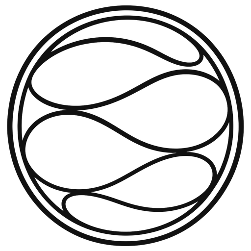
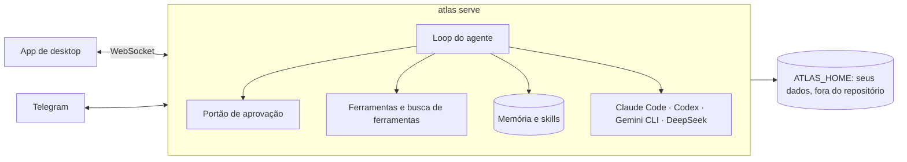

<p align="center">
  <picture>
    <source media="(prefers-color-scheme: dark)" srcset="docs/assets/logo-dark.png">
    
  </picture>
</p>

<h1 align="center">Atlas</h1>

<p align="center">
  <strong>Um agente pessoal que mora na sua máquina, lembra do que importa e passa o trabalho pesado para o agente certo.</strong>
</p>

<p align="center">
  <a href="https://github.com/marqueskaio/atlas/actions/workflows/ci.yml"></a>
  <a href="LICENSE"></a>
  
  
</p>

<p align="center">
  <a href="README.md">English</a> · <b>Português</b> · <a href="README.es.md">Español</a> · <a href="README.zh-CN.md">中文</a>
</p>

---

O Atlas é um agente pessoal de código aberto, com app para desktop. Coloque uma chave de API e você
tem um assistente que guarda uma memória que você consegue ler, escreve as próprias skills conforme
aprende como você trabalha, roda rotinas agendadas e comanda o Claude Code, o Codex, o Gemini CLI ou
o harness da DeepSeek quando um deles é a ferramenta certa. Ele roda no seu notebook, num servidor
ou num container, e tudo o que sabe sobre você fica numa pasta que é sua.

## Por que o Atlas

- **O harness é enxuto; quem trabalha é o modelo.** O Atlas melhora toda vez que os modelos
  melhoram. Poucas ferramentas ficam sempre ligadas e o resto é achado por busca, então cada chamada
  ao modelo fica pequena e focada.
- **A memória é texto puro.** O seu perfil e as anotações do agente são arquivos que você abre,
  edita e versiona. Nenhum banco vetorial escondido decidindo o que você disse.
- **Seguro por construção.** Todo comando passa por um portão de aprovação. Algumas coisas nunca
  rodam, em modo nenhum. Tudo o que sai da sua máquina em seu nome, como fazer merge de um pull
  request ou mandar um e-mail, sempre pergunta antes.
- **Seu.** Sem conta, sem telemetria, sem nuvem nossa. Use o provedor de modelos que preferir.

## Ele melhora enquanto você trabalha

A cada tantas mensagens, uma cópia do agente relê a conversa em segundo plano e guarda o que ela
ensinou, para você nunca precisar corrigir a mesma coisa duas vezes:

- **Quem você é** vai para o seu perfil, e **fatos sobre o seu ambiente** (manias de ferramentas,
  caminhos, convenções) para as anotações do agente.
- **Como fazer um tipo de tarefa** vira skill. Quando você corrige o estilo ou o jeito de
  trabalhar dele, quando aparece uma correção ou um contorno, ou quando uma skill se mostra
  errada, ele ajusta a skill que cobre aquilo, e só cria uma nova quando nenhuma cobre.
- **Ele ignora o ruído:** um programa que faltava, uma tarefa avulsa, um erro que sumiu sozinho.

Ele não consegue estragar nada às escondidas. Fatos novos entram na hora, mas tudo o que
substituiria ou apagaria uma memória espera como proposta para você aprovar. Ele nunca apaga uma
skill, toda mudança guarda a versão anterior (`atlas skills revert` traz de volta), e as skills
que ele criou e ficaram 30 dias sem uso são arquivadas, nunca as suas.

## O que ele faz

| | |
|---|---|
| 🧠 **Memória que você lê** | Um perfil seu e as anotações do próprio agente, guardados como texto dentro de um limite fixo. Abra, edite, ou pergunte ao Atlas o que ele sabe. |
| 🛠️ **Skills que ele mesmo escreve** | Quando o Atlas aprende como algo é feito, salva uma skill, com versões e desfazer. Já vem com skills para GitHub, Gmail e Google Agenda. |
| 🤝 **Delega para outros agentes** | Claude Code, Codex, Gemini CLI e o harness da DeepSeek são executores: o Atlas abre sessões neles, acompanha e troca de conta. Subagentes dividem trabalhos grandes em paralelo. |
| ⏰ **Rotinas** | Prompts e comandos agendados, escritos em palavras ("every weekday at 9") ou em cron. |
| 🤖 **Bots** | Agentes com nome, cada um com sua missão, memória, skills e rotinas, ao lado do principal. Eles conversam entre si. |
| 📱 **Telegram** | Fale com o Atlas pelo celular. Só entra quem você parear. |
| 🌐 **Um navegador só dele** | O Atlas comanda o próprio Chrome, e você pode assumir a qualquer momento. |
| 🔐 **Portão de aprovação e cofre** | Comandos perigosos perguntam, os piores nunca rodam, um modelo revisor lê os comandos sinalizados e um modo automático deixa você passar o volante. As chaves de API ficam num cofre criptografado. |
| 🧩 **Plugins** | Acrescente skills, comandos, agentes, hooks, monitores, servidores MCP e ferramentas. Os hooks usam os eventos e o JSON do Claude Code. |
| 🖥️ **Várias máquinas, várias casas** | Um só app alcança o Atlas nos seus outros computadores por SSH ou Tailscale. Casas separadas mantêm trabalho e vida pessoal à parte. |
| 📦 **Backups e gastos** | Um zip com os seus dados (nunca o cofre) e uma restauração que confere tudo antes. Gastos por dia, modelo e finalidade. |

## Instalação

**Windows**, no PowerShell:

```powershell
irm https://gist.githubusercontent.com/marqueskaio/4e04aef1d784d6d6518f12e466621266/raw/install.ps1 | iex
```

**macOS e Linux**, num terminal:

```bash
curl -fsSL https://gist.githubusercontent.com/marqueskaio/4e04aef1d784d6d6518f12e466621266/raw/install.sh | bash
```

O instalador traz tudo o que o Atlas precisa (Python, Node e ferramentas próprios, conferidos contra
hashes fixados), compila o app de desktop e abre. O app pede a chave de API de um provedor de
modelos, e você já está conversando com o Atlas. Para atualizar, rode a mesma linha de novo; o
`atlas update` também atualiza, e volta para onde estava se algum passo falhar.

**Num container:** o começo do [docker-compose.yml](docker-compose.yml) tem os três comandos: subir,
guardar uma chave de API e pegar o token de que o app de desktop precisa.

### Provedores de modelos

OpenAI, Anthropic, Google Gemini e OpenRouter com chave de API, e modelos locais pelo Ollama ou
pelo vLLM. Cada conversa pode trocar de modelo.

## Como funciona



O Atlas tem o próprio loop de agente, sem framework de agentes por baixo: ele fala com o SDK
oficial de cada provedor. O servidor é a única fonte da verdade, e o app de desktop, o Telegram e
as outras máquinas são clientes dele. Tudo sobre você (perfil, memória, conversas, configurações,
cofre) fica no `ATLAS_HOME`, nunca no código.

## Documentação

Os documentos estão em inglês.

- [Memória](docs/MEMORY.md): o que o Atlas lembra, como, e como mudar
- [Ferramentas](docs/TOOLS.md): cada ferramenta do agente, e como o resto é achado
- [Bots](docs/BOTS.md): criar um bot e conversar com ele
- [Revisão em segundo plano](docs/BACKGROUND_REVIEW.md): como o Atlas aprende com uma conversa
- [Plugins](docs/PLUGINS.md): escrever um plugin
- [Arquitetura](docs/ARCHITECTURE.md): as decisões e as regras que o código segue
- [Glossário](docs/GLOSSARY.md): as palavras que o Atlas usa

## Situação

O Atlas é novo e anda rápido. É usado todo dia, e uma suíte grande de testes roda a cada mudança:
testes de unidade, o app de desktop de verdade de ponta a ponta, os instaladores no Windows e no
Linux, e a imagem do container. Espere arestas e mudanças entre versões. O plano está no
[ROADMAP.md](ROADMAP.md).

## Contribuindo

Issues e pull requests são bem-vindos. Leia o [AGENTS.md](AGENTS.md) para saber como trabalhar no
código, e o [docs/ARCHITECTURE.md](docs/ARCHITECTURE.md) antes de escrever qualquer linha: o CI
cobra as regras dele.

```bash
uv sync                 # instala (o uv cuida do Python 3.13)
uv run pytest           # testes
uv run atlas serve      # o servidor, em 127.0.0.1:18790
cd apps/desktop && npm ci && npm run dev   # o app, a partir do código
```

## Licença

[MIT](LICENSE). Alguns arquivos trazem regras e casos de teste de outros projetos MIT; cada um diz
isso no próprio cabeçalho, e o texto da licença está em [LICENSES/](LICENSES/).
