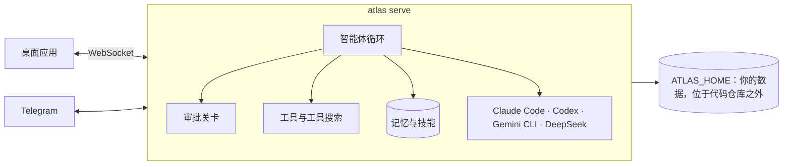

<p align="center">
  <picture>
    <source media="(prefers-color-scheme: dark)" srcset="docs/assets/logo-dark.png">
    
  </picture>
</p>

<h1 align="center">Atlas</h1>

<p align="center">
  <strong>住在你电脑里的个人智能体：记住重要的事，把繁重的工作交给最合适的智能体。</strong>
</p>

<p align="center">
  <a href="https://github.com/marqueskaio/atlas/actions/workflows/ci.yml"></a>
  <a href="LICENSE"></a>
  
  
</p>

<p align="center">
  <a href="README.md">English</a> · <a href="README.pt-BR.md">Português</a> · <a href="README.es.md">Español</a> · <b>中文</b>
</p>

---

Atlas 是一个开源的个人智能体，带有桌面应用。填入一个 API 密钥，你就拥有一个助手：它保存一份你看得懂的记忆，
在了解你的工作方式后自己编写技能（skills），按计划运行例行任务，并在合适的时候调用 Claude Code、Codex、
Gemini CLI 或 DeepSeek 的 harness 来完成工作。它可以运行在你的笔记本、服务器或容器里，
它所知道的关于你的一切都保存在一个属于你的文件夹中。

## 为什么选择 Atlas

- **框架保持轻薄，工作交给模型。** 模型每进步一次，Atlas 就跟着变好。始终开启的工具只有少数几个，
  其余的通过搜索找到，因此每次调用模型都小而专注。
- **记忆就是纯文本。** 你的个人资料和智能体的笔记都是可以打开、编辑和做版本管理的文件。
  没有隐藏的向量数据库替你决定你说过什么。
- **从设计上保证安全。** 每条命令都要经过审批关卡。有些操作在任何模式下都不会执行。
  凡是代表你离开本机的操作，比如合并 pull request 或发送邮件，都会先征求你的同意。
- **完全属于你。** 无需账号，没有遥测，没有我们的云。使用你喜欢的模型提供商。

## 越用越好

每隔几条消息，智能体的一个副本会在后台重读对话，把其中学到的东西保存下来，让你永远不必把同一件事纠正两次：

- **你是谁**写进你的个人资料，**关于你环境的事实**（工具的怪癖、路径、约定）写进智能体的笔记。
- **某类任务怎么做**会变成技能。当你纠正它的风格或工作方式、出现了新的修复或变通办法、
  或者某个技能被证明有误时，它会修改覆盖这类任务的技能，只有在没有合适技能时才新建一个。
- **它会忽略噪音：** 缺失的程序、一次性的任务、自行消失的错误。

它不会在暗中搞坏任何东西。新的事实立即生效，但任何会替换或删除记忆的改动都会作为提议，等你批准。
它从不删除技能，每次修改都会保留上一个版本（`atlas skills revert` 可以恢复），
它自己创建、30 天未使用的技能会被归档，而你的技能永远不会。

## 功能

| | |
|---|---|
| 🧠 **看得懂的记忆** | 一份关于你的资料和智能体自己的笔记，以文本形式保存在固定的容量内。你可以打开、编辑，或直接问 Atlas 它知道什么。 |
| 🛠️ **自己编写技能** | Atlas 学会一件事怎么做时，会保存为技能，支持版本和撤销。内置 GitHub、Gmail 和 Google 日历的技能。 |
| 🤝 **委派给其他智能体** | Claude Code、Codex、Gemini CLI 和 DeepSeek 的 harness 都是执行器：Atlas 在其中启动会话、跟踪进度并切换账号。子智能体可以并行拆分大型任务。 |
| ⏰ **例行任务** | 定时运行的提示词和命令，可以用自然语言（"every weekday at 9"）或 cron 表达式编写。 |
| 🤖 **机器人** | 与主智能体并存的具名智能体，各自拥有使命、记忆、技能和例行任务，彼此之间可以通信。 |
| 📱 **Telegram** | 用手机和 Atlas 对话。只有你配对过的人才能进入。 |
| 🌐 **专属浏览器** | Atlas 驱动自己的 Chrome，你可以随时接管。 |
| 🔐 **审批关卡与保险库** | 危险命令需要确认，最危险的永远不会执行，被标记的命令由一个审查模型阅读，自动模式让你把方向盘交出去。API 密钥保存在加密的保险库中。 |
| 🧩 **插件** | 可以添加技能、命令、智能体、钩子、监视器、MCP 服务器和工具。钩子使用 Claude Code 的事件和 JSON 格式。 |
| 🖥️ **多台机器，多个空间** | 一个应用即可通过 SSH 或 Tailscale 连接你其他电脑上的 Atlas。独立的空间（home）让工作与生活互不干扰。 |
| 📦 **备份与用量** | 一个包含你数据的 zip（从不包含保险库），恢复前会先完整校验。按天、模型和用途统计花费。 |

## 安装

**Windows**，在 PowerShell 中：

```powershell
irm https://gist.githubusercontent.com/marqueskaio/4e04aef1d784d6d6518f12e466621266/raw/install.ps1 | iex
```

**macOS 和 Linux**，在终端中：

```bash
curl -fsSL https://gist.githubusercontent.com/marqueskaio/4e04aef1d784d6d6518f12e466621266/raw/install.sh | bash
```

安装程序会带来 Atlas 所需的一切（独立的 Python、Node 和工具，并按固定的哈希值校验），
编译桌面应用并打开它。应用会要求输入一个模型提供商的 API 密钥，然后你就可以和 Atlas 对话了。
再次运行同一行命令即可更新；`atlas update` 也可以更新，任何一步失败都会回到原来的状态。

**在容器中：** [docker-compose.yml](docker-compose.yml) 开头列出了三条命令：启动、保存 API 密钥，
以及获取桌面应用所需的令牌。

### 模型提供商

使用 API 密钥接入 OpenAI、Anthropic、Google Gemini 和 OpenRouter，也可以通过 Ollama 或 vLLM
使用本地模型。每个对话都可以切换模型。

## 工作原理



Atlas 有自己的智能体循环，底层不依赖任何智能体框架：它直接调用各个提供商的官方 SDK。
服务器是唯一的事实来源，桌面应用、Telegram 和其他机器都是它的客户端。
关于你的一切（资料、记忆、对话、设置、保险库）都保存在 `ATLAS_HOME` 中，从不写进代码。

## 文档

文档为英文。

- [记忆](docs/MEMORY.md)：Atlas 记住什么、如何记住，以及如何修改
- [工具](docs/TOOLS.md)：智能体的每个工具，以及其余工具如何被找到
- [机器人](docs/BOTS.md)：创建机器人并与之对话
- [后台复盘](docs/BACKGROUND_REVIEW.md)：Atlas 如何从对话中学习
- [插件](docs/PLUGINS.md)：编写插件
- [架构](docs/ARCHITECTURE.md)：代码遵循的决策与规则
- [术语表](docs/GLOSSARY.md)：Atlas 使用的词汇

## 当前状态

Atlas 还很年轻，进展很快。它每天都在被使用，每次改动都会运行一整套测试：单元测试、真实桌面应用的端到端测试、
Windows 和 Linux 上的安装程序测试，以及容器镜像测试。版本之间可能会有粗糙之处和变化。
路线图见 [ROADMAP.md](ROADMAP.md)（葡萄牙语）。

## 参与贡献

欢迎提交 issue 和 pull request。请阅读 [AGENTS.md](AGENTS.md) 了解如何参与开发，
并在写代码之前阅读 [docs/ARCHITECTURE.md](docs/ARCHITECTURE.md)：CI 会强制执行其中的规则。

```bash
uv sync                 # 安装（uv 负责管理 Python 3.13）
uv run pytest           # 运行测试
uv run atlas serve      # 启动服务器，地址 127.0.0.1:18790
cd apps/desktop && npm ci && npm run dev   # 从源码运行应用
```

## 许可证

[MIT](LICENSE)。少数文件包含来自其他 MIT 项目的规则和测试用例；每个文件都在自己的文件头中注明，
许可证全文见 [LICENSES/](LICENSES/)。
